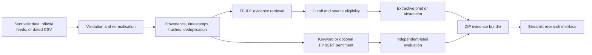

# Market Intelligence AI Platform

A source-grounded financial-news research application for collecting dated evidence, scoring headline sentiment, producing linked extractive briefs, and evaluating NLP methods against independently supplied labels.

This repository is an educational research product. It does not provide investment advice, predict returns, or claim that a cited headline independently verifies a financial conclusion.

## Business problem

Market analysts need to separate three questions that are often blurred together:

1. What did a source publish, and when was it available to the system?
2. Which items are relevant to a research question?
3. How well does a sentiment method perform against labels assigned independently of the model?

The current release answers those questions for a bounded set of financial headlines. It preserves source links and availability times, abstains when it cannot find eligible evidence, and exports the exact inputs and settings behind a brief.

## Implemented features

- Deterministic synthetic demonstration data, visibly labelled as synthetic.
- On-demand ingestion from Federal Reserve and European Central Bank RSS/Atom feeds.
- Upload of dated CSV news with schema and timestamp validation.
- Publication, retrieval, and first-available timestamps stored separately.
- URL canonicalisation, tracking-parameter removal, article hashing, and duplicate removal.
- Transparent keyword sentiment baseline and risk-term flags.
- Optional FinBERT inference pinned to a specific model revision.
- TF-IDF headline retrieval with a historical evidence cutoff.
- Source-linked extractive briefs with explicit abstention.
- Citation-validity and exact-extract checks kept separate from semantic support judgments.
- Sentiment evaluation using independently supplied labels, accuracy, macro F1, and a confusion matrix.
- Downloadable ZIP bundles containing articles, claims, citation checks, settings, and a dataset hash.
- Streamlit dashboard, offline unit tests, compatibility CI, and recorded research-run support.

Market prices, macroeconomic series, company fundamentals, filings RAG, generative research agents, event studies, fixed-income analytics, and a knowledge graph are planned work. They are not implemented in this release.

## Current interface

The dashboard has three research areas:

- **Evidence brief:** retrieve eligible source-linked headlines for a query and cutoff.
- **News explorer:** inspect timestamps, sources, sentiment, risk flags, and URLs.
- **Research evaluation:** compare a selected sentiment method with independent labels and audit the current brief's citations.

Real screenshots will be added after a verified local browser acceptance session. Placeholder images are deliberately not used.

## Architecture



The complete target architecture and its sequencing are documented in [PRODUCT_VISION.md](docs/PRODUCT_VISION.md) and [ROADMAP.md](docs/ROADMAP.md).

## Technology choices

| Component | Choice | Reason |
|---|---|---|
| Interface | Streamlit | Fast, testable Python interface for a bounded research workflow. |
| Data handling | pandas, NumPy | Explicit tabular transformations and portable exports. |
| Retrieval | scikit-learn TF-IDF and cosine similarity | Transparent lexical baseline before introducing embeddings. |
| HTTP and XML | requests and standard-library XML parsing | Small, inspectable ingestion surface with size/entity checks. |
| Optional NLP | ProsusAI FinBERT | Finance-specific sentiment comparator, isolated from the default install. |
| Charts | Plotly | Available for later analytical views; current interface is evidence-first. |

## Methodology

### Keyword sentiment baseline

For headline tokens, the baseline counts predefined positive and negative terms:

```text
raw score = positive matches - negative matches
sentiment score = clip(raw score / 3, -1, 1)
```

Scores above `0.15` are labelled Positive, scores below `-0.15` are Negative, and the remainder are Neutral. This is a transparent baseline rather than a claim of linguistic sophistication.

### Evidence retrieval

Eligible headlines must be non-synthetic, have a public source URL, and satisfy both:

```text
published_at <= cutoff
available_at <= cutoff
```

The query and eligible headlines are represented with unigram/bigram TF-IDF vectors. Ranking uses cosine similarity:

```text
cosine(q, d) = (q · d) / (||q|| ||d||)
```

Only positive-similarity results are returned. When none qualify, the system abstains instead of fabricating a summary.

### Evaluation

Accuracy measures the share of correct predictions. Macro F1 calculates F1 independently for Negative, Neutral, and Positive labels and averages the three values, so a frequent class cannot dominate the result. The included 18-item diagnostic fixture is small, synthetic, and author-labelled; it verifies mechanics rather than external validity.

## Data and model sources

| Source | Use | Current handling |
|---|---|---|
| Federal Reserve monetary-policy RSS | Official policy-announcement headlines | Fetched only on request; failures are displayed and never replaced silently. |
| European Central Bank announcements RSS | Official central-bank headlines | Same handling as the Federal Reserve feed. |
| User CSV | User-provided dated headlines | Validated locally; source rights and confidentiality remain the user's responsibility. |
| Synthetic generator | Offline interface demonstration | Clearly labelled and excluded from sourced briefs. |
| ProsusAI/finbert revision `f210365...` | Optional sentiment comparator | Separate dependencies; model revision exported with evaluation results. |

See [DATA_AND_MODEL_SOURCES.md](docs/DATA_AND_MODEL_SOURCES.md) for URLs, provenance fields, licensing notes, and operating constraints.

## Installation

Python 3.12 and 3.13 are the compatibility targets.

### Windows

From PowerShell in the repository:

```powershell
py -3.13 launch.py setup
py -3.13 launch.py
```

Python 3.12 is also supported. `Start.cmd` and `Start.ps1` automatically try 3.13, then 3.12, then a compatible `python` command. The launcher creates `.venv` inside the repository and does not modify system packages.

### macOS or Linux

```bash
python3.12 launch.py setup
python3.12 launch.py
```

The tested direct dependency versions are in `requirements-tested.txt`. This file is not a complete transitive lockfile. Optional FinBERT packages are installed separately:

```bash
pip install -r requirements-finbert.txt
```

Model weights may be downloaded on first use. Review the model terms before enabling that path.

## How to use the application

1. Start with **Synthetic demonstration** to inspect the interface without external data. The Evidence brief correctly abstains because synthetic headlines are ineligible as sources.
2. Choose **Official feeds**, press **Fetch official feeds**, and inspect the diagnostics before interpreting results.
3. Enter search terms and a UTC cutoff in **Evidence brief**. Open the returned source links and download the evidence bundle.
4. Use **Upload dated CSV** for your own sources. Required fields are `headline` and `published_at`; `url`, `source`, and a recorded `available_at` are strongly recommended.
5. In **Research evaluation**, upload a distinct `headline,label` dataset or run the small diagnostic fixture. Treat its result as a functional check.

Detailed commands and troubleshooting are in [QUICKSTART.md](docs/QUICKSTART.md).

## Reproducible research commands

```bash
python launch.py tests
python launch.py research
python launch.py research --live
```

The research launcher records logs, dependency versions, commit identity, exit status, and changed output artifacts under `runs/`. A successful command proves execution, not research validity.

## Recorded results

The dated experiment in [RESEARCH_RESULTS.md](docs/RESEARCH_RESULTS.md) reports:

- Local lexicon: accuracy `0.6667`, macro F1 `0.6667` on 18 diagnostic headlines.
- FinBERT: accuracy `0.7222`, macro F1 `0.7313` on the same fixture.
- A recorded live ingestion of 12 Federal Reserve and 14 ECB entries.

These are historical recorded checks, not results rerun by every clone. Eighteen examples are insufficient to establish robust model superiority, and upstream feeds naturally change.

## Testing and validation

```bash
python -m unittest discover -s tests -v
```

The suite checks timestamp availability, irrelevant-query abstention, exclusion of synthetic evidence, URL cleaning, duplicate removal, RSS/Atom parsing, citation semantics, the FinBERT output contract, independent-label requirements, export contents, the Streamlit demo path, and launcher run recording.

GitHub Actions runs the default suite on Windows and Ubuntu with Python 3.12 and 3.13. Optional network access and actual FinBERT weights are outside the default CI path and must be reported separately.

## Deployment

No hosted deployment is claimed. The verified target for this milestone is a local Streamlit demonstration. A public deployment must add operating limits, privacy guidance for uploads, secrets management, persistent-source design, and a review of third-party data/model terms. Deployment requires separate approval.

## Limitations and responsible use

- A headline is a report by a source, not independent verification of the event or its financial significance.
- Citation validity only checks whether references resolve to eligible records; it does not prove entailment.
- Sentiment describes language and is not a forecast of returns.
- Publication time may precede the time the system first observed an item.
- TF-IDF retrieves lexical overlap and can miss synonyms or context.
- The default label fixture is not representative of financial news.
- Official feeds cover only a narrow part of the complete market-intelligence vision.
- Uploaded data may be confidential; do not expose it through a public instance.
- This project is independently developed and is not endorsed by Bloomberg, Imperial College London, UCL, the Federal Reserve, the ECB, or ProsusAI.

## Learning connections

The current implementation demonstrates Python and statistical evaluation, market-news provenance, central-bank context, transparent NLP baselines, and reproducible research. It connects to completed Bloomberg Market Concepts, Bloomberg Finance Fundamentals, and HKUST Python and Statistics for Financial Analysis learning. Planned or in-progress courses are not presented as completed credentials.

## Development status

The complete target includes market, macroeconomic, fundamental, RAG, agent, event-study, fixed-income/FX, reporting, graph, and cloud capabilities. Those areas are sequenced in [ROADMAP.md](docs/ROADMAP.md). Verified progress, blockers, exact commits, and the next three priorities are maintained in [DEVELOPMENT_STATUS.md](docs/DEVELOPMENT_STATUS.md).

## Author

Derek Ohimai Isokpehi — [GitHub](https://github.com/iso-derek)
