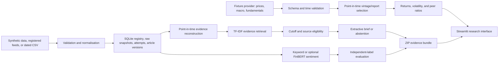

# Market Intelligence AI Platform

A point-in-time finance and source-grounded news research application. It demonstrates adjusted-price analytics, macro vintages, company restatements and ratios, dated evidence, linked extractive briefs, and independently labelled NLP evaluation.

This repository is an educational research product. It does not provide investment advice, predict returns, or claim that a cited headline independently verifies a financial conclusion.

## Business problem

Market analysts need to separate three questions that are often blurred together:

1. What did a source publish, and when was it available to the system?
2. Which items are relevant to a research question?
3. How well does a sentiment method perform against labels assigned independently of the model?

The current release answers those questions for a bounded set of financial headlines and adds a deterministic three-company finance lab. It preserves source links and availability times, abstains when it cannot find eligible evidence, and makes price adjustments, data revisions, report versions, units, and cutoff times visible.

## Implemented features

- Deterministic synthetic demonstration data, visibly labelled as synthetic.
- On-demand ingestion from Federal Reserve and European Central Bank RSS/Atom feeds.
- Persistent SQLite source registry with enable/disable controls and public-HTTPS validation.
- Immutable raw-feed snapshots, append-only fetch attempts, visible source health, and replayable snapshot exports.
- Idempotent imports that preserve revised article versions and historical evidence cutoffs.
- Upload of dated CSV news with schema and timestamp validation.
- Publication, retrieval, and first-available timestamps stored separately.
- URL canonicalisation, tracking-parameter removal, article hashing, and duplicate removal.
- Transparent keyword sentiment baseline and risk-term flags.
- Optional FinBERT inference pinned to a specific model revision.
- TF-IDF headline retrieval with a historical evidence cutoff.
- Source-linked extractive briefs with explicit abstention.
- Citation-validity and exact-extract checks kept separate from semantic support judgments.
- Sentiment evaluation using independently supplied labels, accuracy, macro F1, and a confusion matrix.
- Downloadable ZIP bundles containing articles, claims, citation checks, settings, and a dataset hash.
- Streamlit dashboard, offline unit tests, compatibility CI, and recorded research-run support.
- Provider-isolated educational price, macro, and fundamental fixtures for ALP, BET, and GAM.
- Raw and split-adjusted closes, adjusted-price returns, and sample volatility annualized with a 252-session convention.
- Revision-aware macro history and complete-report restatement handling at historical cutoffs.
- Point-in-time net margin, current ratio, and debt-to-equity peer comparisons with visible currency, units, calendars, source, and availability.
- Versioned deterministic company/ticker registry with boundary-aware aliases and explicit resolved, ambiguous, and unknown outcomes.
- Transparent seven-class event taxonomy with tied-category ambiguity, company/sector linkage, and a hashed independently labelled diagnostic report.
- Frozen balanced 30-item sentiment holdout with per-class metrics, deterministic bootstrap intervals, rule-vocabulary overlap review, and exported model/data identities.
- Hash-verified bounded filings corpus with safe local paths, exact document and passage hashes, explicit page/section/period metadata, and point-in-time availability.

Live market/macro/filings providers, filings RAG, generative research agents, event studies, fixed-income analytics, and a knowledge graph are planned work. They are not implemented in this release. D2 finance records are fictional educational fixtures, not live coverage.

## Current interface

The dashboard has five workspaces:

- **Market, macro & fundamentals:** inspect adjusted/raw prices, returns, volatility, macro vintages, complete report versions, and company peers at two historical cutoffs.
- **Event study tab:** align before/after-close releases to trading sessions and inspect market-adjusted abnormal returns without causal claims.
- **Rates & FX tab:** inspect tenor-labelled yields, benchmark-matched credit spreads in basis points, and BASE/QUOTE performance with explicit direction.
- **News evidence:** use the three research areas below.

- **Evidence brief:** retrieve eligible source-linked headlines for a query and cutoff.
- **News explorer:** inspect timestamps, sources, sentiment, risk flags, and URLs.
- **Entity resolution:** audit exact company/ticker links, shared-alias ambiguity, unknown mentions, and resolver version without inferring return impact.
- **Event taxonomy:** inspect classified, ambiguous, and unknown event language plus conservative company/sector links.
- **Filings corpus:** inspect verified reports, search eligible passages, compare frozen retrieval metrics, and receive extractive passage-cited answers or explicit abstentions.
- **Research workflow:** inspect Company, Macro, News, Risk, and Synthesis roles with tool allowlists, budgets, missing-source states, and a hash-identified trace.
- **Evidence graph & operations:** inspect point-in-time provenance links, bounded paths, graph identity, required-file health, and the verified-local-demo boundary.
- **Research evaluation:** compare a selected sentiment method with independent labels and audit the current brief's citations.

Real screenshots will be added after a verified local browser acceptance session. Placeholder images are deliberately not used.

## Architecture



The complete target architecture and its sequencing are documented in [PRODUCT_VISION.md](docs/PRODUCT_VISION.md) and [ROADMAP.md](docs/ROADMAP.md).

## Technology choices

| Component | Choice | Reason |
|---|---|---|
| Interface | Streamlit | Fast, testable Python interface for a bounded research workflow. |
| Data handling | pandas, NumPy | Explicit tabular transformations and portable exports. |
| Retrieval | scikit-learn TF-IDF and seeded truncated SVD | Comparable lexical and transparent dense-vector baselines without a remote model dependency. |
| HTTP and XML | requests and standard-library XML parsing | Small, inspectable ingestion surface with size/entity checks. |
| Persistence | SQLite | Transactional local storage, versioned schema, immutable payloads, and portable operation without a service dependency. |
| Optional NLP | ProsusAI FinBERT | Finance-specific sentiment comparator, isolated from the default install. |
| Charts | Native Streamlit/Vega charts | Accessible, dependency-light views for the bounded analytical lab. |

## Methodology

### Point-in-time finance analytics

Every finance record must have `available_at <= cutoff`. Macro history selects the latest eligible vintage for each observation. Company history selects one complete eligible report version so a restated fact cannot leak into an earlier cutoff or be mixed with an older report.

Returns use adjusted close:

```text
simple return_t = adjusted_close_t / adjusted_close_(t-1) - 1
annualized volatility = sample_std(daily simple returns) × sqrt(252)
```

The peer view calculates net margin, current ratio, and debt to equity from the latest eligible fiscal period. See [MARKET_DATA_METHODOLOGY.md](docs/MARKET_DATA_METHODOLOGY.md) for schemas, formula definitions, hand-checked revision/restatement examples, and limitations.

### Keyword sentiment baseline

For headline tokens, the baseline counts predefined positive and negative terms:

```text
raw score = positive matches - negative matches
sentiment score = clip(raw score / 3, -1, 1)
```

Scores above `0.15` are labelled Positive, scores below `-0.15` are Negative, and the remainder are Neutral. This is a transparent baseline rather than a claim of linguistic sophistication.

### Evidence retrieval

Eligible headlines must be non-synthetic, have a public source URL, and satisfy both:

```text
published_at <= cutoff
available_at <= cutoff
```

The query and eligible headlines are represented with unigram/bigram TF-IDF vectors. Ranking uses cosine similarity:

```text
cosine(q, d) = (q · d) / (||q|| ||d||)
```

Only positive-similarity results are returned. When none qualify, the system abstains instead of fabricating a summary.

Filing retrieval uses a shared point-in-time interface for unigram/bigram TF-IDF and a deterministic dense LSA vector baseline. The latter projects the TF-IDF matrix with seeded truncated SVD; it is not a pretrained language-model embedding. The eight frozen authored relevance cases report recall@3, mean reciprocal rank, and nDCG@3. These diagnostic metrics are regression evidence, not external model validation.

### Evaluation

Accuracy measures the share of correct predictions. Macro F1 calculates F1 independently for Negative, Neutral, and Positive labels and averages the three values, so a frequent class cannot dominate the result. The included 18-item diagnostic fixture is small, synthetic, and author-labelled; it verifies mechanics rather than external validity.

## Data and model sources

| Source | Use | Current handling |
|---|---|---|
| Federal Reserve monetary-policy RSS | Official policy-announcement headlines | Fetched only on request; failures are displayed and never replaced silently. |
| European Central Bank announcements RSS | Official central-bank headlines | Same handling as the Federal Reserve feed. |
| User CSV | User-provided dated headlines | Validated locally; source rights and confidentiality remain the user's responsibility. |
| Synthetic generator | Offline interface demonstration | Clearly labelled and excluded from sourced briefs. |
| ProsusAI/finbert revision `f210365...` | Optional sentiment comparator | Separate dependencies; model revision exported with evaluation results. |
| Repository-authored finance fixtures | Offline prices, macro vintages, and company reports | Fictional values with explicit units and availability; never represented as live observations. |

See [DATA_AND_MODEL_SOURCES.md](docs/DATA_AND_MODEL_SOURCES.md) for URLs, provenance fields, licensing notes, and operating constraints. The SQLite schema, time semantics, migrations, replay rules, and backup boundary are documented in [PERSISTENCE.md](docs/PERSISTENCE.md).

The event categories, uncertainty rules, linkage semantics, labelled diagnostic, and limitations are documented in [EVENT_TAXONOMY.md](docs/EVENT_TAXONOMY.md).

The frozen sentiment split, per-class metrics, bootstrap method, vocabulary-overlap review, and responsible interpretation are documented in [SENTIMENT_EVALUATION.md](docs/SENTIMENT_EVALUATION.md).

The bounded report manifest, parser grammar, integrity checks, time semantics, and corpus limitations are documented in [FILINGS_CORPUS.md](docs/FILINGS_CORPUS.md).

The filing retrieval contract, frozen relevance diagnostic, ranking metrics, and interpretation limits are documented in [RETRIEVAL_EVALUATION.md](docs/RETRIEVAL_EVALUATION.md).

The extractive answer contract, citation schema, defensive text boundary, frozen QA diagnostic, and abstention limits are documented in [GROUNDED_FILINGS_QA.md](docs/GROUNDED_FILINGS_QA.md).

The role/tool contract, budgets, trace schema, conflict handling, and workflow limitations are documented in [TYPED_WORKFLOWS.md](docs/TYPED_WORKFLOWS.md).

Release-to-session alignment, abnormal-return formulas, cutoff safeguards, and inference limits are documented in [EVENT_STUDIES.md](docs/EVENT_STUDIES.md).

Yield, spread, currency-pair, quote-direction, and point-in-time conventions are documented in [RATES_AND_FX.md](docs/RATES_AND_FX.md).

Graph validation, relationship semantics, bounded traversal, artifact identity, and local-operations boundaries are documented in [EVIDENCE_GRAPH_AND_OPERATIONS.md](docs/EVIDENCE_GRAPH_AND_OPERATIONS.md).

The frozen graph-versus-table comparison, exactness definition, operation counts, and negative-result interpretation are documented in [GRAPH_VALUE_EVALUATION.md](docs/GRAPH_VALUE_EVALUATION.md).

The claim-level citation contract, numeric reconciliation checks, and immutable report bundle are documented in [RECONCILED_RESEARCH_REPORTS.md](docs/RECONCILED_RESEARCH_REPORTS.md).

## Installation

Python 3.12 and 3.13 are the compatibility targets.

### Windows

From PowerShell in the repository:

```powershell
py -3.13 launch.py setup
py -3.13 launch.py
```

Python 3.12 is also supported. `Start.cmd` and `Start.ps1` automatically try 3.13, then 3.12, then a compatible `python` command. The launcher creates `.venv` inside the repository and does not modify system packages.

### macOS or Linux

```bash
python3.12 launch.py setup
python3.12 launch.py
```

The tested direct dependency versions are in `requirements-tested.txt`. This file is not a complete transitive lockfile. Optional FinBERT packages are installed separately:

```bash
pip install -r requirements-finbert.txt
```

Model weights may be downloaded on first use. Review the model terms before enabling that path.

## How to use the application

1. Choose **Market, macro & fundamentals** and compare the 31 January and 1 March historical views. Inspect ALP's split, CPI revision, and complete report restatement.
2. Switch to **News evidence** and start with **Synthetic demonstration**. The Evidence brief correctly abstains because synthetic headlines are ineligible as sources.
3. Choose **Official feeds**, review the persistent registry, select enabled sources, press **Fetch selected sources**, and inspect source health before interpreting results.
4. Reopen the app to confirm persisted evidence remains available, or download an immutable snapshot from **Manage registered sources**.
5. Enter search terms and a UTC cutoff in **Evidence brief**. Open the returned source links and download the evidence bundle.
6. Use **Upload dated CSV** for your own sources. Required fields are `headline` and `published_at`; `url`, `source`, and a recorded `available_at` are strongly recommended.
7. In **Research evaluation**, upload a distinct `headline,label` dataset or run the small diagnostic fixture. Treat its result as a functional check.

Detailed commands and troubleshooting are in [QUICKSTART.md](docs/QUICKSTART.md).

## Reproducible research commands

```bash
python launch.py tests
python launch.py research
python launch.py research --live
```

The research launcher records logs, dependency versions, commit identity, exit status, and changed output artifacts under `runs/`. A successful command proves execution, not research validity.

## Recorded results

The dated experiment in [RESEARCH_RESULTS.md](docs/RESEARCH_RESULTS.md) reports:

- Local lexicon: accuracy `0.6667`, macro F1 `0.6667` on 18 diagnostic headlines.
- FinBERT: accuracy `0.7222`, macro F1 `0.7313` on the same fixture.
- A recorded live ingestion of 12 Federal Reserve and 14 ECB entries.

These are historical recorded checks, not results rerun by every clone. Eighteen examples are insufficient to establish robust model superiority, and upstream feeds naturally change.

## Testing and validation

```bash
python -m unittest discover -s tests -v
```

The suite checks timestamp availability, irrelevant-query abstention, exclusion of synthetic evidence, URL cleaning, duplicate removal, RSS/Atom parsing, citation semantics, the FinBERT output contract, independent-label requirements, export contents, SQLite migration, idempotent snapshots, revision preservation, cutoff invariance, visible outages, replay exports, split-adjusted return and volatility calculations, macro vintage selection, complete-report restatements, ratios, provider isolation, conservative entity/ticker resolution, the Streamlit demo/registry paths, and launcher run recording.

GitHub Actions runs the default suite on Windows and Ubuntu with Python 3.12 and 3.13. Optional network access and actual FinBERT weights are outside the default CI path and must be reported separately.

## Deployment

No hosted deployment is claimed. The verified target is a local Streamlit demonstration. SQLite persistence is implemented for a single local process; a public deployment still requires operating limits, concurrency and backup design, privacy guidance for uploads, secrets management, and a review of third-party data/model terms. Deployment requires separate approval.

## Limitations and responsible use

- A headline is a report by a source, not independent verification of the event or its financial significance.
- Citation validity only checks whether references resolve to eligible records; it does not prove entailment.
- Sentiment describes language and is not a forecast of returns.
- Publication time may precede the time the system first observed an item.
- TF-IDF retrieves lexical overlap and can miss synonyms or context.
- The default label fixture is not representative of financial news.
- Official feeds cover only a narrow part of the complete market-intelligence vision.
- SQLite is a local single-instance store; multi-worker hosting and automated backup/restore are not implemented.
- Finance analytics use a tiny fictional fixture. They do not establish live-provider accuracy, production coverage, or a statistically stable volatility estimate.
- Uploaded data may be confidential; do not expose it through a public instance.
- This project is independently developed and is not endorsed by Bloomberg, Imperial College London, UCL, the Federal Reserve, the ECB, or ProsusAI.

## Learning connections

The current implementation demonstrates Python and statistical evaluation, market-news provenance, central-bank context, transparent NLP baselines, and reproducible research. It connects to completed Bloomberg Market Concepts, Bloomberg Finance Fundamentals, and HKUST Python and Statistics for Financial Analysis learning. Planned or in-progress courses are not presented as completed credentials.

## Development status

The complete target includes market, macroeconomic, fundamental, RAG, agent, event-study, fixed-income/FX, reporting, graph, and cloud capabilities. Those areas are sequenced in [ROADMAP.md](docs/ROADMAP.md). Verified progress, blockers, exact commits, and the next three priorities are maintained in [DEVELOPMENT_STATUS.md](docs/DEVELOPMENT_STATUS.md).

## Author

Derek Ohimai Isokpehi — [GitHub](https://github.com/iso-derek)
